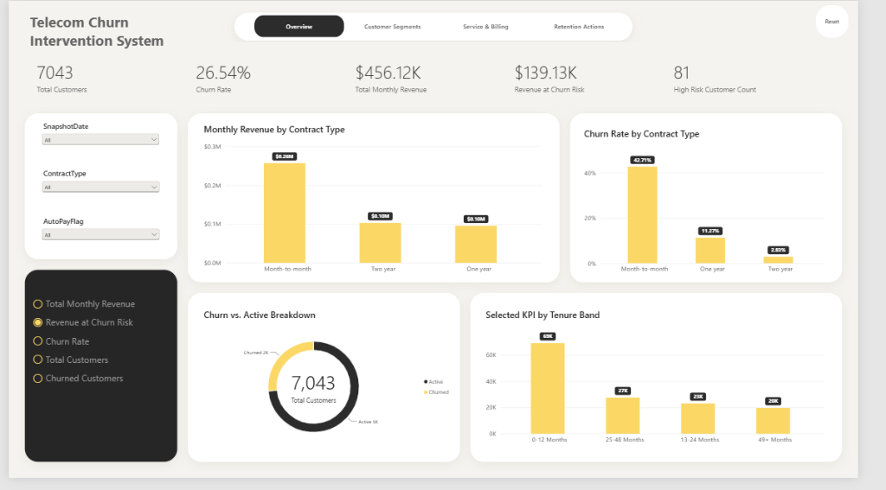
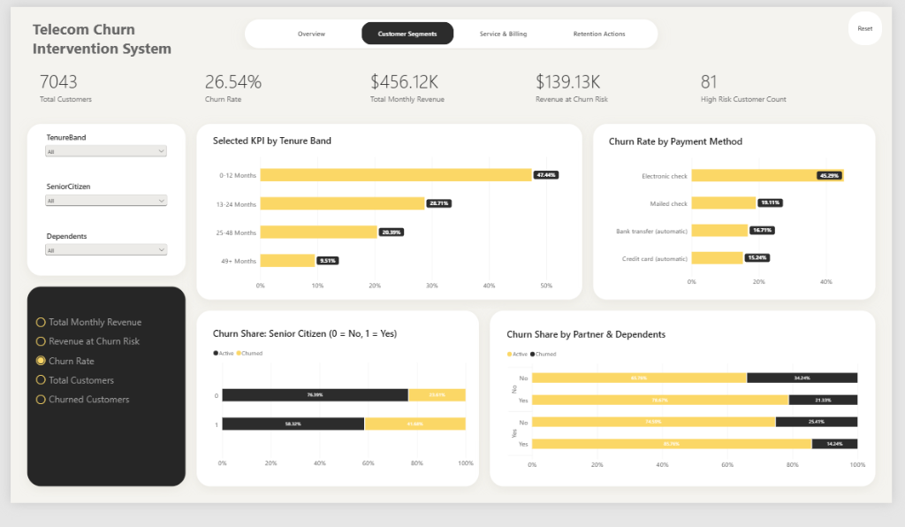
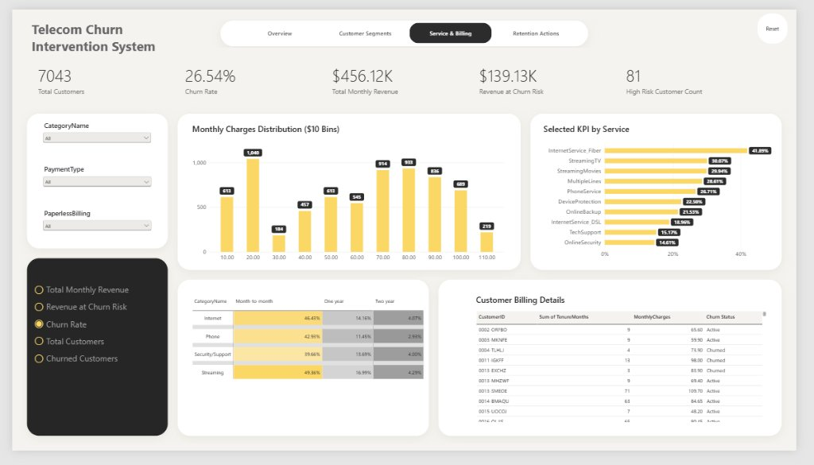
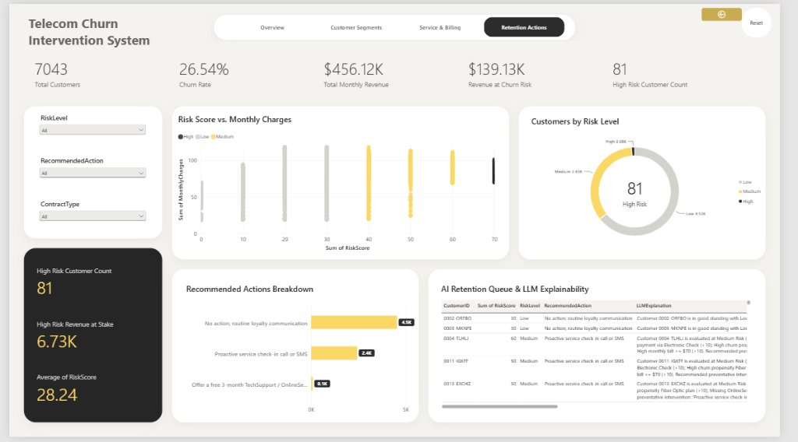

# Telecom Churn Intervention System

**Academic Course:** Data Warehousing & Business Intelligence (BDS-5B)  
**Institution:** FAST National University of Computer and Emerging Sciences, Karachi  
**Team:**  
- Sameer Danish (Group Leader) - 24K-2504  
- Muhammad Arham - 24K-2529  
- Hadeer Abbas - 24K-2503  

---

## 📌 Project Architecture & Overview
The Telecom Churn Intervention System is an end-to-end data warehousing, business intelligence, and AI-driven decision-support solution. It integrates:
1. **Primary Dataset:** Kaggle IBM Telco Customer Churn (`Telco-Customer-Churn.csv`, ~7,043 customer records).
2. **Supporting Synthetic Sources:**
   - Synthetic Customer Support Ticket Log (`data/raw/synthetic_support_tickets.csv`)
   - Synthetic Plan/Tariff & Retention-Offer Reference Table (`data/raw/synthetic_plans_tariffs.csv`)

### Multi-Layer Lakehouse & Warehouse Flow:
- **Staging Layer:** `stg_customers`, `stg_tickets`, `stg_plans`
- **Lakehouse / Processing Layers:**
  - **Bronze:** Raw data preserved as loaded.
  - **Silver:** Cleaned, validated, and normalized dimensional entities.
  - **Gold:** Aggregated, snapshot-consistent dimensional warehouse tables.
- **Dimensional Schema:** Star schema featuring a snowflaked service dimension (`DimService` -> `DimServiceCategory`), `DimCustomer`, `DimContract`, `DimPayment`, `DimSnapshotDate`, `FactCustomerChurn`, `FactCustomerService`, and `FactRetentionAction`.
- **Data Marts:** Customer Mart and Retention Mart.
- **AI Intervention:** A perceive-reason-act Intelligent Rule Agent coupled with an LLM explainer with automated write-back into `FactRetentionAction`.
- **BI Delivery:** Interactive 4-page Power BI dashboard for executive, CRM, and retention operations.

---

## 📂 Repository Structure
```
DWBI/
├── data/
│   ├── raw/                 # Source CSVs (IBM Telco + Synthetic files)
│   ├── bronze/              # Raw ingested extracts
│   ├── silver/              # Cleaned & joined datasets
│   └── gold/                # Curated dimensional warehouse extracts
├── sql/
│   ├── 01_staging_bronze_ddl.sql       # Staging & Bronze table schemas
│   ├── 02_silver_gold_warehouse_ddl.sql # Fact & Dimension schemas (Star/Snowflake)
│   └── 03_indexes_and_marts.sql        # Indexes, EXPLAIN benchmarks, Data Mart views
├── src/
│   ├── config.py                       # Configuration & DB connection parameters
│   ├── generate_synthetic_data.py      # Reproducible synthetic data generator
│   ├── etl_pipeline.py                 # Multi-layer ETL pipeline
│   ├── retention_agent.py              # Rule-based perceive-reason-act agent
│   └── llm_explainer.py                # LLM & fallback retention explanation generator
├── notebooks/
│   └── 01_eda_and_rule_tuning.ipynb    # EDA, statistics, & rule calibration
├── todos.md                            # Project tracking roadmap
├── .env.example                        # Database and LLM environment template
├── requirements.txt                    # Python dependencies
└── README.md                           # Documentation & execution guide
```

---

## 📊 Dimensional Modeling & Data Mart Architecture
- **Snowflaked Service Dimension:** `DimService` normalizes operational telecom add-ons (DSL, Fiber, OnlineSecurity, Streaming) linked to outrigger `DimServiceCategory`.
- **Many-to-Many Resolution:** Handled through the `FactCustomerService` bridge table (70,430 rows).
- **AI Decision Support Mart:** `FactRetentionAction` captures automated customer churn intervention scores (0-100), risk tiers (Low/Medium/High), actionable offers, and LLM explainability narratives written directly back from the DeepSeek reasoning engine.
- **Power BI Implementation:** 4-page executive and operational dashboard connected via Star Schema to local MySQL 8.0 warehouse.

---

## 🖥️ Interactive Power BI Dashboard

The project includes an executive-grade 4-page Power BI dashboard designed in a warm neutral beige and charcoal aesthetic with dynamic KPI metric switching:

### 1. Executive Overview

*Highlights: 7,043 Customers, 26.54% Churn Rate, $456.12K Total Monthly Revenue, $139.13K Revenue at Churn Risk, 81 High Risk Customers.*

### 2. Customer Segments

*Highlights: Churn rate by tenure band (0–12 Months at 47.44%), payment method breakdown (Electronic check at 45.29%), and demographic splits.*

### 3. Service & Billing Analysis

*Highlights: Monthly charge distribution histogram, service churn propensity (Fiber Optic leading at 41.89%), and service category matrix.*

### 4. AI Retention Actions & LLM Explainability

*Highlights: Risk score distribution, 81 High-Risk customers prioritized, action breakdown, and live LLM write-back explanations displayed directly in the CRM queue.*

---

## 🚀 Setup Instructions
1. Clone the repository and navigate into the workspace:
   ```bash
   cd DWBI
   ```
2. Set up a Python virtual environment:
   ```bash
   python -m venv venv
   .\venv\Scripts\activate
   pip install -r requirements.txt
   ```
3. Copy `.env.example` to `.env` and fill in your MySQL credentials and (optional) LLM API key.
4. Execute synthetic generation:
   ```bash
   python src/generate_synthetic_data.py
   ```

